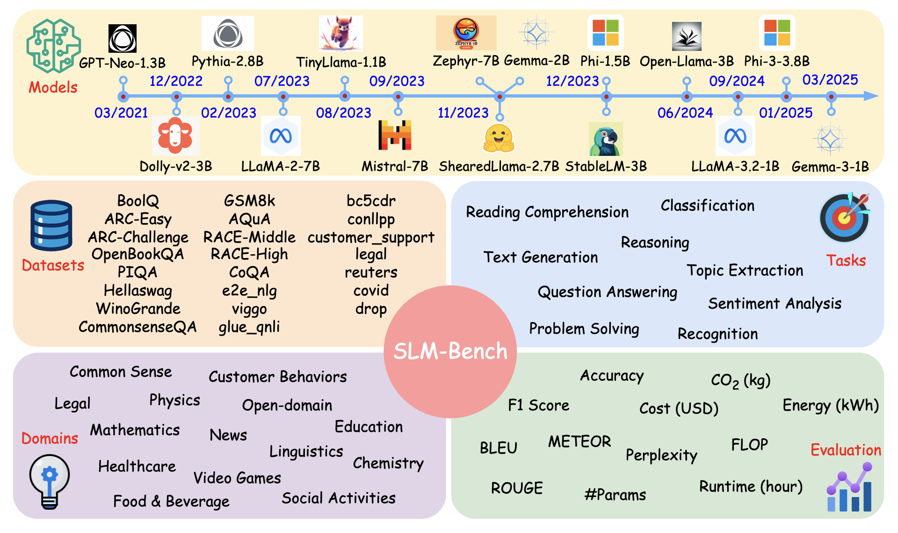
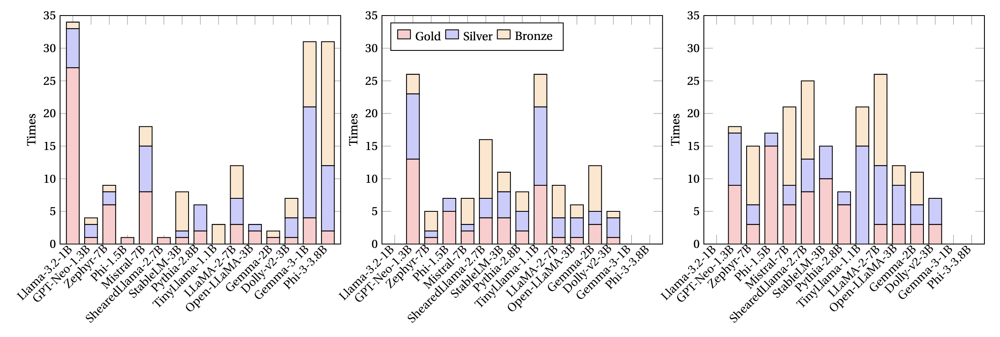

# SLM-Bench: A Comprehensive Benchmark of Small Language Models on Environmental Impacts

[](https://opensource.org/licenses/MIT)

## Abstract

Small Language Models (SLMs) offer computational efficiency and accessibility, yet a systematic evaluation of their performance and environmental impact remains lacking. We introduce SLM-Bench, the first benchmark specifically designed to assess SLMs across multiple dimensions, including accuracy, computational efficiency, and sustainability metrics. SLM-Bench evaluates 15 SLMs on 9 NLP tasks using 23 datasets spanning 14 domains. The evaluation is conducted on 4 hardware configurations, providing a rigorous comparison of their effectiveness. Unlike prior benchmarks, SLM-Bench quantifies 11 metrics across correctness, computation, and consumption, enabling a holistic assessment of efficiency trade-offs. Our evaluation considers controlled hardware conditions, ensuring fair comparisons across models. We develop an open-source benchmarking pipeline with standardized evaluation protocols to facilitate reproducibility and further research. Our findings highlight the diverse trade-offs among SLMs, where some models excel in accuracy while others achieve superior energy efficiency. SLM-Bench sets a new standard for SLM evaluation, bridging the gap between resource efficiency and real-world applicability.

## Introduction

Recent advancements in Language Models (LMs) have revolutionized NLP applications across domains. However, the impressive performance of Large Language Models (LLMs) comes with significant computational costs and environmental challenges. Small Language Models (SLMs) have emerged as a promising solution to mitigate these negative impacts by significantly reducing the number of parameters while maintaining reasonable performance.

Despite their growing prominence, a notable gap exists in the systematic evaluation of SLMs. SLM-Bench addresses this gap by providing a comprehensive benchmarking framework for evaluating SLMs with a specific focus on their environmental impacts.



## Key Features

- **Focus on Small Language Models**: Evaluates SLMs (models of up to 7B-class size) that are computationally efficient and accessible to a wider range of users and systems
- **Measurement of Environmental Impacts**: Integrates metrics for energy consumption and CO2 emissions to assess sustainability, an aspect often overlooked in benchmarking
- **Evaluation Across Diverse Settings**: Rigorously evaluates 15 SLMs on 9 tasks using 23 datasets from 14 domains

## Datasets

SLM-Bench incorporates 23 diverse datasets spanning 14 domains and 9 task types:

| Dataset | #Samples | Domain | Task |
|---------|----------|--------|------|
| BoolQ | 15,432 | Open-domain | Question Answering |
| ARC-Easy | 5,876 | Open-domain | Question Answering |
| ARC-Challenge | 2,590 | Open-domain | Question Answering |
| OpenBookQA | 5,957 | Open-domain | Question Answering |
| PIQA | 16,113 | Physics | Reasoning |
| Hellaswag | 10,421 | Common Sense | Reasoning |
| WinoGrande | 44,321 | Common Sense | Reasoning |
| CommonsenseQA | 12,102 | Common Sense | Reasoning |
| GSM8k | 8,034 | Mathematics | Problem Solving |
| AQuA | 99,765 | Mathematics | Problem Solving |
| RACE-Middle | 24,798 | Education | Reading Comprehension |
| RACE-High | 26,982 | Education | Reading Comprehension |
| CoQA | 127,542 | Open-domain | Question Answering |
| e2e_nlg | 50,321 | Food & Beverage | Text Generation |
| viggo | 9,842 | Video Games | Text Generation |
| glue_qnli | 104,543 | Linguistics | Question Answering |
| bc5cdr | 20,764 | Chemistry | Recognition |
| conllpp | 23,499 | Linguistics | Recognition |
| customer_support | 14,872 | Customer Behaviors | Classification |
| legal | 49,756 | Legal | Classification |
| reuters | 9,623 | News | Topic Extraction |
| covid | 19,874 | Healthcare | Sentiment Analysis |
| drop | 96,567 | Open-domain | Reasoning |

`datasets.json` records where `train.py` loads each dataset from (Hub ID, config and splits) and how it formats examples. Where the original source no longer loads with current `datasets` releases, it uses an equivalent copy:

- PIQA: `baber/piqa`
- e2e_nlg, viggo: the GEM versions
- bc5cdr: `tner/bc5cdr`
- conllpp: the CrossWeigh raw files on GitHub
- customer_support: `PolyAI/banking77`
- legal: LexGLUE LEDGAR
- reuters: `Tellurio/reuters-21578`
- covid: `argilla/twitter-coronavirus`, the Kaggle Coronavirus Tweets NLP data, using a 90/10 split of its single train split

## Models

SLM-Bench evaluates 15 SLMs selected based on model size (up to 7B-class), popularity, and open-source availability:

| Model | Provider | #Params (B) | Size (GB) | Year |
|-------|----------|-------------|-----------|------|
| GPT-Neo-1.3B | EleutherAI | 1.32 | 2.63 | 03/2021 |
| Open-LLaMA-3B | OpenLM Research | 3.43 | 6.85 | 06/2023 |
| LLaMA-2-7B | Meta | 6.74 | 13.48 | 07/2023 |
| Mistral-7B | Mistral AI | 7.24 | 14.48 | 09/2023 |
| Zephyr-7B | Hugging Face H4 | 7.24 | 14.48 | 10/2023 |
| Phi-1.5 | Microsoft | 1.42 | 2.84 | 09/2023 |
| TinyLlama-1.1B | SUTD | 1.10 | 2.20 | 12/2023 |
| StableLM-3B | Stability AI | 2.80 | 5.59 | 09/2023 |
| ShearedLlama-2.7B | Princeton NLP | 2.70 | 5.40 | 10/2023 |
| Dolly-v2-3B | Databricks | 2.78 | 5.55 | 04/2023 |
| Gemma-2B | Google | 2.51 | 5.01 | 02/2024 |
| Pythia-2.8B | EleutherAI | 2.78 | 5.55 | 02/2023 |
| Llama-3.2-1B | Meta | 1.24 | 2.47 | 09/2024 |
| Phi-3-3.8B | Microsoft | 3.82 | 7.64 | 04/2024 |
| Gemma-3-1B | Google | 1.00 | 2.00 | 03/2025 |

#Params counts trainable parameters; Size is the 16-bit (FP16/BF16) weight footprint, #Params × 2 bytes. Year is the public release month (for TinyLlama, the final 3T-token checkpoint). The first 12 models are configured in `models.json`; Llama-3.2-1B, Phi-3-3.8B and Gemma-3-1B are not yet. Databricks has removed Dolly-v2-3B from the Hugging Face Hub, so that entry currently fails to load.

## Evaluation Metrics

SLM-Bench employs 11 metrics categorized into three groups:

1. **Correctness Evaluation**
   - Accuracy
   - F1 Score
   - BLEU
   - ROUGE
   - METEOR
   - Perplexity

2. **Computation Evaluation**
   - Runtime
   - FLOP (Floating Point Operations)

3. **Consumption Evaluation**
   - Cost (USD)
   - CO2 Emissions (kg)
   - Energy Usage (kWh)



## Benchmarking Pipeline

Our benchmarking pipeline consists of 7 key modules:

1. **Universal Data Loader**: Converts datasets into a unified structure
2. **Preprocessing**: Refines data through trimming and transformation
3. **Calling**: Manages execution of SLMs and tasks
4. **Postprocessing**: Refines model outputs
5. **Evaluation**: Applies appropriate metrics
6. **Report**: Compiles results and visualizations
7. **Logging**: Records events throughout for traceability

## Key Findings

Our evaluation reveals several important insights:

- **Performance Trade-offs**: Different models excel in different aspects - some offer superior accuracy while others prioritize energy efficiency
- **Top Performers**:
  - **Correctness**: Zephyr-7B and Mistral-7B achieved the highest accuracy
  - **Computation**: GPT-Neo-1.3B and TinyLlama-1.1B demonstrated the best computational efficiency
  - **Consumption**: Phi-1.5B and StableLM-3B minimized resource consumption most effectively
- **Well-Balanced Models**: GPT-Neo-1.3B and ShearedLlama-2.7B maintained strong overall performance across all three categories

## Recommendations

Based on our findings, we recommend:

- For accuracy-focused applications: Zephyr-7B or Mistral-7B
- For computationally-constrained environments: Phi-1.5B or ShearedLlama-2.7B
- For minimizing environmental impact: Phi-1.5B or GPT-Neo-1.3B
- For balanced performance: GPT-Neo-1.3B or ShearedLlama-2.7B

## Installation & Usage

Requires Python 3.12 and an NVIDIA GPU with a driver that supports CUDA 13 (driver 580 or newer). Tested on an NVIDIA GB10 (DGX Spark).

```bash
# Clone the repository
git clone https://github.com/HiveIntel/SLM-Bench.git
cd SLM-Bench

# Install dependencies (CUDA 13.0 build of PyTorch first)
python3 -m venv .venv && source .venv/bin/activate
pip install torch==2.14.1 --index-url https://download.pytorch.org/whl/cu130
pip install -r requirements.txt

# Gated models (LLaMA-2, Gemma) need a Hugging Face token with access granted
hf auth login

# Run every model in models.json against every dataset in datasets.json
python train.py

# Or pick models and datasets by name
python train.py --models TinyLlama-1.1 Phi-1.5 --datasets BoolQ ARC-Easy conllpp
```

For each model × dataset pair, `train.py` fine-tunes the model as a causal LM on prompt → answer text (100 training examples, 1 epoch by default). It computes the loss on the answer tokens only, then evaluates on 50 held-out examples. Each run writes `experiment_results/<model>_<dataset>_results.json` with:

- eval loss and perplexity
- answer token accuracy
- exact match, meaning every answer token is predicted correctly; this equals greedy-decoding exact match
- training and evaluation runtime
- peak GPU memory
- energy, CO2 and electricity cost for training and for evaluation (see below)

### Energy measurement

`energy.py` measures energy with no extra dependencies and picks a backend automatically:

| Device | Source | What it covers |
|--------|--------|----------------|
| DGX Spark and other NVIDIA GPUs | NVML hardware energy counter | GPU only. CPU, memory and the rest of the system are not included. |
| Jetson Orin / Xavier, Jetson Nano / TX2 | INA3221 power monitor in sysfs, sampled every 50 ms and integrated | The module input rail (`VDD_IN` / `POM_5V_IN`) when the board has one; otherwise the sum of all rails (e.g. AGX Orin) |

Before each experiment, `train.py` measures the idle power for `--idle-seconds` (10 s by default). The `energy` block in the results JSON then reports, separately for `train` and `eval`:

- `total_energy_j` and `avg_power_w`: everything the sensor saw
- `net_energy_j` and `net_avg_power_w`: with the idle baseline subtracted
- `tokens` (non-padding tokens processed) and `net_j_per_token`
- `scope`, `duration_s` and per-rail energy, so you can check what was measured

Caveats:

- NVML reports the whole GPU, so other processes using it during a run are counted too. Subtracting the baseline removes their steady draw, not their bursts.
- The sensors average over up to about a second, so phases shorter than about 5 s are imprecise; `train.py` logs a warning when that happens. Raise `--eval-samples` or `--train-samples` to get longer phases.
- For whole-system or wall-plug energy, use an external power meter.

### CO2 and cost

For each phase, `train.py` turns the measured energy into CO2 and electricity cost:

```
system energy   = scope factor × measured energy + scope offset × duration
facility energy = system energy × PUE
CO2             = facility energy × grid carbon intensity during the phase
```

**Net and total.** Every figure comes in two versions. `net_*` uses the energy the experiment added on top of the idle baseline, which is its marginal cost. `total_*` also charges the idle power drawn while it ran, which is the attributional view used by most footprint tools. The scope offset cancels out of the net figures, because the idle baseline contains it too.

**Scope.** The sensors miss part of the system (on DGX Spark they see only the GPU). To correct for this, plug the device into a wall-plug power meter and run:

```bash
python energy.py calibrate
```

It runs the GPU at four load levels, asks for the wall-meter reading at each, fits `wall = offset + factor × sensor`, and prints the `--scope-factor`, `--scope-offset-w` and `--scope-uncertainty` flags to use. Without calibration the factor is 1 and the offset 0, so the figures cover only what the sensor sees.

**Grid carbon intensity.** By default this is a fixed `--carbon-intensity` (480 gCO2/kWh, roughly the world average). With `--carbon-zone` it uses the intensity for that place and time, averaged over each phase:

| `--carbon-source` | Data | Notes |
|---|---|---|
| `energy-charts` (default with a zone) | Fraunhofer ISE [Energy-Charts](https://energy-charts.info), 15-minute values for European countries (`--carbon-zone DE`) | No API key. Actual values appear about two hours late; until then the forecast is used. |
| `electricity-maps` | [Electricity Maps](https://www.electricitymaps.com), hourly lifecycle intensity for any zone | Needs `ELECTRICITYMAPS_API_KEY`. The free tier covers only the last 24 hours. |

Any part of a phase the source can't cover (offline, too old, not yet published) falls back to the fixed value. Each phase records the intensity it used and its mix of `actual`, `estimated`, `forecast` and `fixed` data.

**Uncertainty.** Each CO2 figure has `_low` and `_high` worst-case bounds combining:

- sensor accuracy: ±5 W for NVML (NVIDIA's stated accuracy), and an assumed ±5 % for Jetson sensors
- `--scope-uncertainty`: the calibration fit error
- grid intensity, assumed to be ±10 % for actual data, ±15 % for estimates, ±20 % for forecasts and ±30 % for a fixed value; `--carbon-intensity-uncertainty` overrides this

They are bounds, not a statistical confidence interval.

**Other settings.** `--pue` adds data-centre overhead (default 1.0, right for a desk device; data centres are typically 1.1–1.6). `--electricity-price` sets the USD/kWh price for cost figures (default 0.15, a placeholder).

**Recomputing.** All settings are stored in `energy.carbon` with each result, so the figures can be recomputed later without rerunning anything. Use this once actual grid data has replaced the forecast, or after calibrating the scope:

```bash
python carbon.py update experiment_results
python carbon.py update experiment_results --scope-factor 1.9 --scope-offset-w 32 --scope-uncertainty 0.05
```

Flags given to `update` override the stored settings.

Useful options:

| Option | What it does |
|--------|--------------|
| `--train-samples`, `--eval-samples` | Number of training and evaluation examples |
| `--max-length` | Maximum tokens per example (long contexts are trimmed from the left) |
| `--batch-size`, `--epochs`, `--seed` | Training settings |
| `--gpu-memory-fraction` | Caps this process's share of GPU memory on a shared GPU |
| `--idle-seconds` | Length of the idle baseline window before each experiment (0 turns off baseline subtraction) |
| `--carbon-zone`, `--carbon-source`, `--carbon-intensity`, `--pue`, `--scope-*`, `--electricity-price` | CO2 and cost settings (see above) |
| `--no-energy` | Skips energy, CO2 and cost measurement |
| `--results-dir` | Where results are written (default `experiment_results`) |

Full fine-tuning keeps FP32 weights and AdamW state, so plan on roughly 16 GB of GPU memory per billion parameters, plus activations. For example, about 18 GB for TinyLlama-1.1B and about 120 GB for the 7B models.

### Optional email notifications

Progress and final-report emails are off by default. To turn them on, pass `--email` and provide SMTP credentials through the environment (never commit them):

```bash
export SMTP_USER="sender@example.com"
export SMTP_PASSWORD="your-app-password"
# Optional, defaults shown
export SMTP_SERVER="smtp.gmail.com"
export SMTP_PORT="587"

python train.py --email you@example.com
```

### Docker

```bash
docker build -t slm-bench .
docker run --gpus all -e HF_TOKEN \
  -v "$PWD/experiment_results:/app/experiment_results" \
  -v "$PWD/cache:/app/cache" \
  slm-bench
```

The container runs as an unprivileged user (UID 1000), so mounted host directories must be writable by that UID. The image installs the CUDA 13.0 build of PyTorch, builds on both x86_64 and arm64 hosts, and needs the NVIDIA Container Toolkit for `--gpus`.

## Citation

```bibtex
@inproceedings{author2024slmbench,
  title={SLM-Bench: A Comprehensive Benchmark of Small Language Models on Environmental Impacts},
  author={Author, Anonymous},
  booktitle={Proceedings of the Annual Meeting of the Association for Computational Linguistics},
  year={2024}
}
```

## License

This project is licensed under the MIT License 

## Links

- [SLM-Bench Source Code](https://github.com/HiveIntel/SLM-Bench)
- [SLM-Bench Leaderboard](https://swarm.hiveintel.ai/leaderboard/)
